# Entity-relationship diagram

Generated from the database by `pnpm db:erd` (2026-11-21). Do not edit by hand.
Every table has Row Level Security enabled; see `supabase/migrations` and `docs/phase-3.md`.

```mermaid
erDiagram
  addresses {
    uuid id PK
    uuid household_id FK
    text line1
    text line2
    text city
    text state
    text zip
    text delivery_notes
    boolean is_default
    double lat
    double lng
    timestamptz created_at
    timestamptz updated_at
  }
  allergens {
    uuid id PK
    text name
    text slug
    boolean is_top9
    text icon
    integer sort_order
    timestamptz created_at
    timestamptz archived_at
  }
  allergy_overrides {
    uuid id PK
    uuid child_id FK
    uuid menu_item_id FK
    uuid approved_by FK
    text reason
    timestamptz created_at
    timestamptz revoked_at
  }
  audit_log {
    bigint id PK
    timestamptz occurred_at
    uuid actor_id
    array actor_roles
    text action
    text entity_type
    text entity_id
    jsonb before
    jsonb after
    jsonb changes
    inet ip
    text user_agent
    jsonb metadata
  }
  auth_attempts {
    text key
    text kind
    timestamptz attempted_at
  }
  child_allergens {
    uuid child_id PK
    uuid allergen_id PK
    enum severity
    timestamptz created_at
  }
  children {
    uuid id PK
    uuid household_id FK
    text first_name
    text last_initial
    uuid school_id FK
    uuid classroom_id FK
    text grade
    array dietary_preferences
    text notes
    timestamptz created_at
    timestamptz updated_at
    timestamptz archived_at
  }
  classrooms {
    uuid id PK
    uuid organization_id FK
    text name
    text teacher_name
    text grade
    integer headcount
    text dropoff_location
    timestamptz created_at
    timestamptz updated_at
    timestamptz archived_at
  }
  content_blocks {
    uuid id PK
    text key
    enum type
    text description
    jsonb draft_value
    jsonb published_value
    uuid updated_by FK
    timestamptz updated_at
    timestamptz published_at
    uuid published_by FK
  }
  content_versions {
    uuid id PK
    uuid block_id FK
    jsonb value
    uuid created_by FK
    timestamptz created_at
  }
  delivery_zones {
    uuid id PK
    text name
    array zip_codes
    jsonb polygon_geojson
    integer fee_cents
    integer free_over_cents
    integer min_order_cents
    text currency
    array delivery_weekdays
    text delivery_window_label
    boolean is_active
    integer sort_order
    timestamptz created_at
    timestamptz updated_at
    timestamptz archived_at
  }
  dietary_badges {
    uuid id PK
    text name
    text slug
    text icon
    text color
    integer sort_order
    timestamptz created_at
    timestamptz archived_at
  }
  discount_codes {
    uuid id PK
    text code
    enum type
    integer value
    text currency
    integer max_redemptions
    integer times_redeemed
    timestamptz expires_at
    jsonb applies_to
    text stripe_coupon_id
    boolean is_active
    timestamptz created_at
  }
  email_templates {
    uuid id PK
    text key
    text subject
    text preheader
    jsonb body_rich
    boolean is_active
    timestamptz updated_at
  }
  faqs {
    uuid id PK
    text question
    jsonb answer_rich
    text category
    integer sort_order
    boolean is_published
    timestamptz created_at
    timestamptz updated_at
  }
  favorites {
    uuid id PK
    uuid household_id FK
    uuid child_id FK
    uuid menu_item_id FK
    timestamptz created_at
  }
  household_members {
    uuid household_id PK
    uuid user_id PK
    enum role
    timestamptz created_at
  }
  households {
    uuid id PK
    text name
    uuid primary_user_id FK
    uuid default_zone_id FK
    uuid default_address_id FK
    text stripe_customer_id
    timestamptz created_at
    timestamptz updated_at
  }
  invoices {
    uuid id PK
    uuid organization_id FK
    date period_start
    date period_end
    text stripe_invoice_id
    enum status
    integer total_cents
    text currency
    text pdf_url
    date due_date
    timestamptz created_at
    timestamptz updated_at
  }
  media {
    uuid id PK
    text storage_path
    text alt_text
    integer width
    integer height
    uuid uploaded_by FK
    timestamptz created_at
  }
  menu_categories {
    uuid id PK
    text name
    text slug
    integer sort_order
    boolean is_active
    timestamptz created_at
  }
  menu_item_allergens {
    uuid menu_item_id PK
    uuid allergen_id PK
    enum presence
  }
  menu_item_badges {
    uuid menu_item_id PK
    uuid badge_id PK
  }
  menu_item_images {
    uuid id PK
    uuid menu_item_id FK
    text storage_path
    text alt_text
    integer sort_order
    boolean is_primary
    timestamptz created_at
  }
  menu_items {
    uuid id PK
    text name
    text slug
    text short_description
    jsonb description_rich
    uuid category_id FK
    integer base_price_cents
    integer school_price_cents
    text currency
    text portion_label
    text ingredients
    jsonb nutrition
    boolean is_snack
    boolean is_active
    text stripe_product_id
    timestamptz created_at
    timestamptz updated_at
    timestamptz archived_at
  }
  menu_template_items {
    uuid id PK
    uuid menu_template_id FK
    uuid menu_item_id FK
    integer price_override_cents
    integer capacity
    enum available_for
    integer sort_order
  }
  menu_templates {
    uuid id PK
    text name
    text description
    smallint rotation_position
    timestamptz created_at
    timestamptz updated_at
    timestamptz archived_at
  }
  menu_week_items {
    uuid id PK
    uuid menu_week_id FK
    uuid menu_item_id FK
    integer price_override_cents
    integer capacity
    enum available_for
    integer sort_order
  }
  menu_weeks {
    uuid id PK
    date week_start
    array delivery_dates
    timestamptz ordering_opens_at
    timestamptz cutoff_at
    enum status
    text notes_to_families
    uuid generated_from_template_id FK
    timestamptz created_at
    timestamptz updated_at
  }
  notifications_log {
    uuid id PK
    text to_address
    text template_key
    text status
    text provider_id
    text error
    timestamptz sent_at
  }
  order_items {
    uuid id PK
    uuid order_id FK
    uuid child_id FK
    uuid classroom_id FK
    uuid menu_item_id FK
    date delivery_date
    integer quantity
    integer unit_price_cents
    text currency
    text item_name
    array allergens_contained
    array may_contain
    array badges
    boolean covered_by_subscription
    uuid allergy_override_id FK
    timestamptz created_at
  }
  orders {
    uuid id PK
    text order_number
    uuid household_id FK
    uuid organization_id FK
    uuid menu_week_id FK
    enum source
    enum status
    enum fulfillment
    jsonb address_snapshot
    uuid delivery_zone_id FK
    date delivery_date
    integer subtotal_cents
    integer delivery_fee_cents
    integer discount_cents
    integer tax_cents
    integer total_cents
    text currency
    text stripe_payment_intent_id
    text stripe_invoice_id
    timestamptz allergy_confirmed_at
    uuid allergy_confirmed_by FK
    timestamptz placed_at
    uuid placed_by FK
    text notes
    timestamptz created_at
    timestamptz updated_at
  }
  organizations {
    uuid id PK
    text name
    enum status
    uuid created_by FK
    uuid reviewed_by FK
    timestamptz reviewed_at
    timestamptz created_at
    timestamptz updated_at
    timestamptz archived_at
    enum type
    text billing_email
    smallint billing_terms_days
    boolean tax_exempt
    text stripe_customer_id
    jsonb address
    text dropoff_instructions
    text contact_phone
  }
  pages {
    uuid id PK
    text slug
    text title
    text seo_title
    text seo_description
    text og_image
    jsonb body_draft
    jsonb body_published
    boolean is_published
    timestamptz published_at
    timestamptz created_at
    timestamptz updated_at
    timestamptz archived_at
  }
  pilot_invites {
    uuid id PK
    text code
    text email
    uuid used_by FK
    timestamptz used_at
    timestamptz created_at
  }
  plan_price_history {
    uuid id PK
    uuid plan_id FK
    text stripe_price_id
    integer price_cents
    text currency
    timestamptz active_from
    timestamptz active_to
  }
  plans {
    uuid id PK
    text name
    text slug
    jsonb description_rich
    enum audience
    enum billing_interval
    integer meals_per_interval
    enum allowance_unit
    integer price_cents
    integer price_per_extra_meal_cents
    text currency
    boolean includes_snacks
    integer snacks_per_interval
    boolean allow_skip
    smallint max_skips_per_month
    boolean allow_pause
    boolean rollover_unused
    integer max_rollover
    enum auto_fill_strategy
    smallint min_commitment_intervals
    smallint trial_intervals
    boolean is_active
    integer sort_order
    text stripe_product_id
    text stripe_price_id
    timestamptz created_at
    timestamptz updated_at
    timestamptz archived_at
  }
  profiles {
    uuid id PK
    text full_name
    text phone
    timestamptz created_at
    timestamptz updated_at
    timestamptz deleted_at
  }
  saved_orders {
    uuid id PK
    uuid household_id FK
    text name
    jsonb payload
    timestamptz created_at
    timestamptz updated_at
  }
  site_settings {
    boolean id PK
    text business_name
    text logo_path
    jsonb brand_colors
    text contact_email
    text contact_phone
    jsonb social_links
    text timezone
    smallint default_cutoff_days_before
    time default_cutoff_time
    smallint ordering_opens_days_before
    jsonb tax_settings
    boolean pilot_mode
    boolean ordering_enabled
    jsonb announcement
    date rotation_anchor_week
    smallint rotation_weeks_ahead
    timestamptz updated_at
    uuid updated_by FK
  }
  standing_orders {
    uuid id PK
    uuid organization_id FK
    uuid classroom_id FK
    text name
    array weekdays
    date start_date
    date end_date
    enum status
    enum quantity_mode
    integer fixed_quantity
    enum menu_selection_mode
    text notes
    uuid created_by FK
    timestamptz created_at
    timestamptz updated_at
  }
  stripe_events {
    text event_id PK
    text type
    boolean livemode
    jsonb payload
    timestamptz received_at
    timestamptz processed_at
    text error
  }
  subscription_allowances {
    uuid id PK
    uuid subscription_id FK
    uuid menu_week_id FK
    integer meals_allowed
    integer meals_used
    integer snacks_allowed
    integer snacks_used
    integer rolled_over_in
    boolean skipped
  }
  subscriptions {
    uuid id PK
    uuid household_id FK
    uuid organization_id FK
    uuid plan_id FK
    text stripe_subscription_id
    enum status
    integer quantity
    timestamptz current_period_start
    timestamptz current_period_end
    timestamptz paused_until
    boolean cancel_at_period_end
    timestamptz created_at
    timestamptz updated_at
  }
  testimonials {
    uuid id PK
    text quote
    text attribution
    boolean is_published
    integer sort_order
    timestamptz created_at
  }
  user_roles {
    uuid id PK
    uuid user_id FK
    enum role
    uuid organization_id FK
    uuid granted_by FK
    timestamptz granted_at
  }
  households ||--o{ addresses : "household_id"
  children ||--o{ allergy_overrides : "child_id"
  menu_items ||--o{ allergy_overrides : "menu_item_id"
  allergens ||--o{ child_allergens : "allergen_id"
  children ||--o{ child_allergens : "child_id"
  classrooms ||--o{ children : "classroom_id"
  households ||--o{ children : "household_id"
  organizations ||--o{ children : "school_id"
  organizations ||--o{ classrooms : "organization_id"
  content_blocks ||--o{ content_versions : "block_id"
  children ||--o{ favorites : "child_id"
  households ||--o{ favorites : "household_id"
  menu_items ||--o{ favorites : "menu_item_id"
  households ||--o{ household_members : "household_id"
  addresses ||--o{ households : "default_address_id"
  delivery_zones ||--o{ households : "default_zone_id"
  organizations ||--o{ invoices : "organization_id"
  allergens ||--o{ menu_item_allergens : "allergen_id"
  menu_items ||--o{ menu_item_allergens : "menu_item_id"
  dietary_badges ||--o{ menu_item_badges : "badge_id"
  menu_items ||--o{ menu_item_badges : "menu_item_id"
  menu_items ||--o{ menu_item_images : "menu_item_id"
  menu_categories ||--o{ menu_items : "category_id"
  menu_items ||--o{ menu_template_items : "menu_item_id"
  menu_templates ||--o{ menu_template_items : "menu_template_id"
  menu_items ||--o{ menu_week_items : "menu_item_id"
  menu_weeks ||--o{ menu_week_items : "menu_week_id"
  menu_templates ||--o{ menu_weeks : "generated_from_template_id"
  allergy_overrides ||--o{ order_items : "allergy_override_id"
  children ||--o{ order_items : "child_id"
  classrooms ||--o{ order_items : "classroom_id"
  menu_items ||--o{ order_items : "menu_item_id"
  orders ||--o{ order_items : "order_id"
  delivery_zones ||--o{ orders : "delivery_zone_id"
  households ||--o{ orders : "household_id"
  menu_weeks ||--o{ orders : "menu_week_id"
  organizations ||--o{ orders : "organization_id"
  plans ||--o{ plan_price_history : "plan_id"
  households ||--o{ saved_orders : "household_id"
  classrooms ||--o{ standing_orders : "classroom_id"
  organizations ||--o{ standing_orders : "organization_id"
  menu_weeks ||--o{ subscription_allowances : "menu_week_id"
  subscriptions ||--o{ subscription_allowances : "subscription_id"
  households ||--o{ subscriptions : "household_id"
  organizations ||--o{ subscriptions : "organization_id"
  plans ||--o{ subscriptions : "plan_id"
  organizations ||--o{ user_roles : "organization_id"
```

Also in the database (not drawn): `auth.users` (referenced by profiles, user_roles, household_members and others),
views `site_settings_public`, `content_blocks_public`, `pages_public`, `organization_members` and `kitchen_order_lines`.
